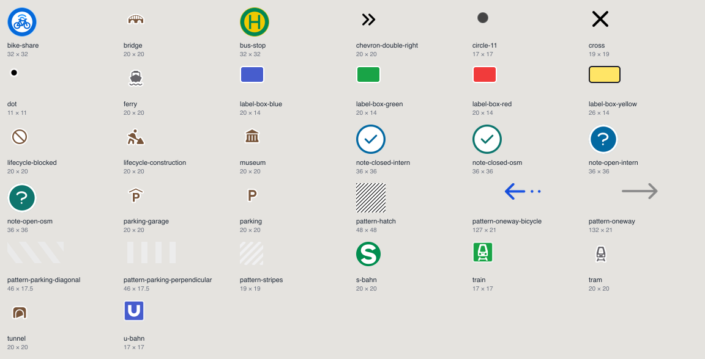

# Map style

## Base style

See [src/server/api/map-style/README.md](../../src/server/api/map-style/README.md).

## Icons (sprite)

The icons that layers use as `icon-image`, `fill-pattern` and `line-pattern`.

- One SVG file per icon in [`icons`](./icons). The file name is the icon id.
- `bun run map-sprite-build` builds `public/map-style/sprite(@2x).png|json` and the overview above.
  Commit the SVG and the built files together.
- The build also writes a hash of the sprite files to `src/server/api/map-style/spriteVersion.const.ts`.
  `/api/map-style` adds it to the sprite URL (`sprite?v=<hash>`), so browsers load a new sprite on the next page load.
- The `width` and `height` of the `<svg>` are the size of the icon on the map in pixels.
  Patterns repeat, so draw them to continue over the edges.
- Ids are kebab-case. Repeating patterns (`fill-pattern`, `line-pattern`) start with `pattern-`.
- `circle-11` keeps its name because the Maptiler base style uses it.
- Static datasets in [tilda-static-data](https://github.com/FixMyBerlin/tilda-static-data) use the ids as well,
  and the app does not know about those uses. When you rename an icon, rename it there too and re-upload those datasets.
- A test checks that every icon the category layers, the notes and debug layers and the base style use exists in the sprite.

### Sources

- `bridge`, `tunnel`, `parking`, `parking-garage`, `museum`, `ferry`, `tram` and the glyph of `train`:
  [Maki](https://github.com/mapbox/maki), CC0.
- `note-*`: the same paths as the Inspector icons in `SidebarInspector/icons`.
- `lifecycle-*`: the same paths as the lifecycle row in the Inspector (`TagsTableRowLifecycle`):
  `lifecycle-construction` is "person-digging" from [Font Awesome Free](https://fontawesome.com/license/free) (CC BY 4.0),
  `lifecycle-blocked` is "no-symbol" from [Heroicons](https://github.com/tailwindlabs/heroicons) (MIT).
- `u-bahn`, `s-bahn`: redrawn. The logos are trademarks; we use them to mark stations.
- `bus-stop`: redrawn after the official German bus stop sign. `bike-share` is drawn in the same way.
- Everything else: drawn for TILDA.
